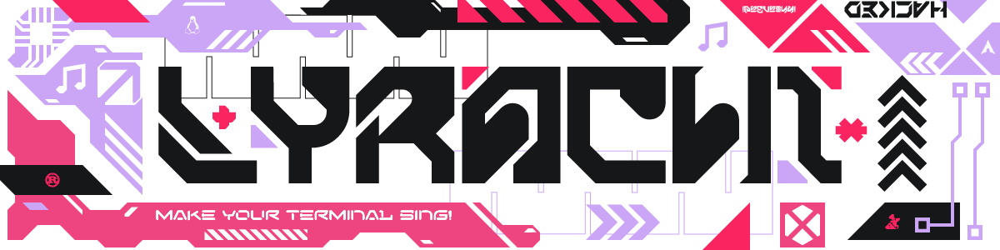

<h1 align="center">
  <picture>
    <source
      srcset="./art/banner.png"
      media="(prefers-color-scheme: dark)"
    />
    
  </picture>
</h1>

<p align="center">
  Real-time synchronized lyrics for your music player, with rich visual stages, live in your terminal
</p>

<div align="center">

[](#building-and-installing)
<!-- [](https://crates.io/crates/lyrachi) -->
[](https://github.com/ikhsan3adi/lyrachi/releases)
<!-- [](https://aur.archlinux.org/packages/lyrachi) -->
[](#building-and-installing)
[](#media-players)
[](LICENSE)

</div>

<div align="center">

Lyrachi is a terminal UI that shows the lyrics of whatever your desktop music player is playing, timed to playback.
It listens to your media player through standard interfaces, resolves lyrics from local files and online providers, and renders them with word-level karaoke highlighting, translations, and duet parts.

</div>

## Preview

> A preview GIF of the cylinder and canvas3d modes is coming here. No
> screenshot has been recorded yet, so this slot stays empty rather than
> showing a mock-up.

## What it does

- Five display modes: a scrolling lyric view, a block view, a kinetic view, a 2.5D rotating cylinder, and a 3D perspective crawl. Cycle with `m`.
- Word-level karaoke highlighting when the lyric source carries word or syllable timing, with a wipe sweep on the active word.
- Annotations rendered alongside the lyrics: translations, romanization, secondary lines, and background vocals, each with its own styling.
- Duet detection: second-singer lines are styled distinctly, whether the source marks them (TTML agents, LyricsPlus singers) or spells them out (QRC singer prefixes).
- Long instrumental gaps get an instrumental marker instead of dead space.
- Per-track offset memory, a global offset, and a lookahead so transitions land on the beat.
- Headless mode: `lyrachi pipe` streams the current line to status bars like waybar, and `lyrachi status --json` reports player and lyric state for scripts.

## Media players

Playback comes from the player, not from Lyrachi. Supported today:

- **MPRIS** on Linux and the BSDs: any player that implements the standard (mpv, Spotify desktop, Firefox, Chromium, Strawberry, and most others).
- **SMTC** on Windows 10 (1809+) and Windows 11: any app that reports to System Media Transport Controls — Spotify desktop, Media Player, browsers, and most native players. Run `lyrachi debug smtc` to list the sessions Lyrachi can see.
- **MPD** over TCP, disabled by default and enabled under `[media.mpd]`.
- **WebNowPlaying**: a local WebSocket bridge for the browser extension, enabled under `[media.webnowplaying]`.

macOS support is planned; see the roadmap below.

## Lyrics sources

Local files are checked first: a local hit ends the lookup before any network request.
Otherwise the network providers race in parallel and the most precise answer wins: syllable-timed over word-timed over line-timed over plain text.
The configured `order` only breaks ties.
Results are cached in SQLite; provider errors are never cached.

- **Local**: `.lrc`, `.elrc`, `.ttml`, `.krc`, `.qrc`, and `.yrc` files next to your audio files or in your music directories. See [`examples/lyrics`](examples/lyrics) for sample files that exercise every annotation type.
- **LRCLIB**: synced, plain, and word-synced lyrics.
- **LyricsPlus, BetterLyrics, Unison**: network providers with rich TTML and JSON payloads, including translations and background vocals.
- **YTMusic**: compiled in by default; drop it with `cargo build --no-default-features`.
- **Experimental** (behind `--features experimental-providers`): Netease Cloud Music, QQ Music, and Kugou.

If a precise answer is still in flight, a less precise one may display immediately and upgrade in place when the better result arrives.

## Building and installing

You need Rust 1.89 or newer.

```sh
cargo install --path .
```

This builds the `lyrachi` binary and puts it on your cargo bin path. To run from a checkout instead:

```sh
cargo run --release
```

Useful build variants:

- `cargo build --no-default-features` removes the YTMusic provider.
- `--features experimental-providers` adds Netease, QQ Music, and Kugou.

## Keyboard reference

The essentials:

| Key             | Action                                                          |
| --------------- | --------------------------------------------------------------- |
| `?`             | Help overlay with every binding, grouped by mode                |
| `m`             | Cycle display mode                                              |
| `w`             | Toggle word highlighting                                        |
| `f` / `t` / `s` | Fullscreen / title header / status bar                          |
| `[` / `]` / `\` | Offset -100 ms / +100 ms / reset                                |
| `c`, `Enter`    | Context menu: pick a lyric source, edit the search, pin a style |
| `q`, `Ctrl+C`   | Quit                                                            |

The complete reference, including stage tuning keys, the context menu, the
search input, and the help overlay, lives in
[`docs/keybindings.md`](docs/keybindings.md).

## Headless usage

Lyrachi can report lyrics without starting the TUI, which makes it usable from scripts and status bars:

- `lyrachi status` prints a snapshot of the active player, playback state, and lyric resolution (source, tier, confidence). `--json` emits the same snapshot as a single JSON object.
- `lyrachi pipe` streams the current lyric line, printing a new frame only when the line changes. This is the mode for status bar integrations such as waybar or polybar:
  - `--format plain` (default) prints the lyric text.
  - `--format json` prints `{"text", "alt", "class", "progress", "backend"}`, shaped for waybar's custom module.
  - `--max-width N` truncates output to a display width.
- `lyrachi --dump-events` prints raw media events for debugging backend integrations.

All flags work after a subcommand, for example `lyrachi pipe --offline`.
Set `LYRACHI_LOG=<filter>` to control log verbosity, and `--log-file <path>` to write logs somewhere other than the default state directory.

## Terminal recommendations

- **Color**: a 24-bit color terminal gives the intended look. Lyrachi detects capability automatically and falls back to 256-color and then 16-color palettes; you can pin the mode with `[terminal] color_mode`. Terminals with reliable truecolor include kitty, Alacritty, WezTerm, Ghostty, foot, GNOME Terminal, and iTerm2.
- **Fonts**: any monospace font with decent Unicode coverage. No patched or Nerd Font is required. If your font renders East Asian Ambiguous characters at two cells, set `[terminal] ambiguous_width = 2`.
- **Size**: 80x24 works; 120x40 or larger shows the full status bar and the richest layout.
- **Glyphs**: if your terminal mangles box-drawing or separator characters, set `[terminal] unicode = "ascii"` for plain fallbacks.

## Configuration

Everything lives in one `config.toml`: player filtering, sync offsets, provider order, media backends, cache size, display tuning, and terminal behavior. The full reference with defaults, ranges, and validation rules is in [`docs/config.md`](docs/config.md). Handy commands:

```sh
lyrachi config print-default   # commented starter config
lyrachi config check           # validate your file and active style
lyrachi config schema          # JSON Schema for editors
lyrachi paths                  # print your actual resolved paths
```

Where your files live:

| File           | Linux / BSD                           | Windows                                     | macOS                                                |
| -------------- | ------------------------------------- | ------------------------------------------- | ---------------------------------------------------- |
| `config.toml`  | `~/.config/lyrachi/config.toml`       | `%APPDATA%\lyrachi\config\config.toml`      | `~/Library/Application Support/lyrachi/config.toml`  |
| `styles/`      | `~/.config/lyrachi/styles/`           | `%APPDATA%\lyrachi\config\styles\`          | `~/Library/Application Support/lyrachi/styles/`      |
| `offsets.json` | `~/.local/share/lyrachi/offsets.json` | `%APPDATA%\lyrachi\offsets.json`            | `~/Library/Application Support/lyrachi/offsets.json` |
| lyric cache    | `~/.cache/lyrachi/lyrics_v1.db`       | `%LOCALAPPDATA%\lyrachi\cache\lyrics_v1.db` | `~/Library/Caches/lyrachi/lyrics_v1.db`              |
| log            | `~/.local/state/lyrachi/lyrachi.log`  | `%LOCALAPPDATA%\lyrachi\lyrachi.log`        | `~/Library/Application Support/lyrachi/lyrachi.log`  |

On Linux and BSD, `XDG_CONFIG_HOME`, `XDG_DATA_HOME`, `XDG_CACHE_HOME`, and `XDG_STATE_HOME` override the `~/.config`, `~/.local/share`, `~/.cache`, and `~/.local/state` prefixes when set.
The `--config <path>` flag moves the config file anywhere; the styles directory always becomes a `styles/` folder next to whatever config file you point at.
`lyrachi paths` prints the real resolved locations on your machine.
(Windows and macOS paths follow the same convention, but no media backend exists there yet.)

Styles are TOML profiles in the `styles/` directory next to your config file, with `extends` inheritance and hot reload.
Four builtin presets ship: `builtin:default`, `builtin:dark`, `builtin:aurora`, and `builtin:minimal`.

## Limitations

- macOS has no media backend yet; the TUI reports no player there.
- On Windows, Lyrachi follows whole SMTC sessions: it cannot tell two browser
  tabs apart, and players that never refresh their timeline report a stale
  sample age.
- On Windows, browsers only carry a playback position when the website pushes
  one (`mediaSession.setPositionState`). Sites that set it once at play start
  leave the position frozen, and sites that never set it report zero, so
  Lyrachi starts from that stale value instead of the real one. Seek or
  pause-resume once to re-anchor, or use the WebNowPlaying extension, which
  reports the position live.
- Online providers need network access. `--offline` or `[providers] network = false` restricts Lyrachi to local files.
- Input is bounded rather than truncated: lyric files up to 256 KiB, HTTP bodies up to 512 KiB, 2,000 lines, and 16,000 word tokens per track.
- The per-track and global offsets are clamped to ±30 seconds.
- A provider that fails three times in a row is benched for five minutes before it is probed again.

## Roadmap

- **Windows**: a Windows CI runner to keep the SMTC backend green.
- **macOS**: a Music.app and Spotify backend with adaptive polling and
  graceful permission fallbacks, plus a macOS CI runner.
- **Stable release**: render benchmarks and UI snapshots finalized for every
  display mode.

After that, the visual era: full bitmap font coverage for CJK and other
scripts in the block and cylinder modes, broader visual and UI polish, more
built-in color schemes, and album artwork with dynamic accent colors. A
spectrum visualizer and beat-synced animation are planned further out.

## Credits

- The QRC singer-prefix rules follow the behavior of the braccato parsers (`@braccato/parsers`).
- Built with ratatui, crossterm, tachyonfx, zbus, rusqlite, notify, toml_edit, glam, and font8x8, among the dependencies listed in [Cargo.toml](Cargo.toml).

## License

GPL-3.0. See [LICENSE](LICENSE).
